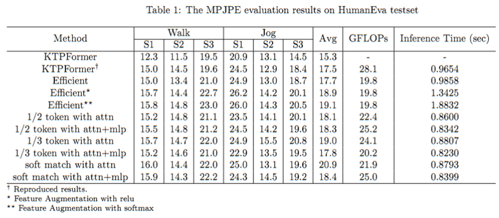

# KTPFormer + Efficient Attention

3D Human Pose Estimation 모델 **KTPFormer**(CVPR 2024)의 Multi-Head Self-Attention 연산 병목을 분석하고,
**EfficientViT**(CVPR 2023)의 Cascaded Group Attention 아이디어를 적용해 계산량을 줄인 개인 연구 프로젝트입니다.

여기에 더해 차원 축소로 인한 표현력 손실을 보완하려는 **Nonlinear Feature Augmentation** 모듈을 직접 설계하고,
ReLU / Softmax 두 가지 방식을 비교 실험했습니다.

- 기간: 2024-11 ~ 2024-12
- 데이터셋: HumanEva-I (15 joints, GT 2D keypoints)
- 소속: 경희대학교 기계공학과 로보틱스 연구실 (석사과정)

---

## 1. 핵심 결과

HumanEva-I testset, Protocol #1 (MPJPE, mm), Walk / Jog 6개 시퀀스 평균.

| Method | Walk S1 | S2 | S3 | Jog S1 | S2 | S3 | **Avg** | **GFLOPs** | **Inference (s)** |
|---|---|---|---|---|---|---|---|---|---|
| KTPFormer (논문 보고값) | 12.3 | 11.5 | 19.5 | 20.9 | 13.1 | 14.5 | **15.3** | - | - |
| KTPFormer† (재현 baseline) | 15.0 | 14.5 | 19.6 | 24.5 | 12.9 | 18.4 | **17.5** | 28.1 | 0.9654 |
| **Efficient** | 15.0 | 13.4 | 21.0 | 24.9 | 13.0 | 18.7 | **17.7** | **19.8** | 0.9858 |
| Efficient* (FA-ReLU) | 15.7 | 14.4 | 22.7 | 26.2 | 14.2 | 20.1 | 18.9 | 19.8 | 1.3425 |
| Efficient** (FA-Softmax) | 15.8 | 14.8 | 23.0 | 26.0 | 14.3 | 20.5 | 19.1 | 19.8 | 1.8832 |
| 1/2 token with attn | 15.2 | 14.8 | 21.1 | 23.5 | 14.1 | 20.1 | 18.1 | 22.4 | 0.8600 |
| 1/2 token with attn+mlp | 15.5 | 14.8 | 21.2 | 24.5 | 14.2 | 19.6 | 18.3 | 25.2 | 0.8342 |
| 1/3 token with attn | 15.7 | 14.7 | 22.0 | 24.9 | 15.5 | 20.8 | 19.0 | 24.1 | 0.8807 |
| 1/3 token with attn+mlp | 15.2 | 14.6 | 21.0 | 22.9 | 13.5 | 19.5 | 17.8 | 20.2 | **0.8230** |
| soft match with attn | 16.0 | 14.4 | 22.0 | 25.0 | 13.1 | 19.6 | 20.9 | 21.9 | 0.8793 |
| soft match with attn+mlp | 15.9 | 14.3 | 22.2 | 24.3 | 14.5 | 19.2 | 18.4 | 25.0 | 0.8399 |

† 재현 결과 / \* Feature Augmentation with ReLU / \*\* Feature Augmentation with Softmax



**주요 수치**

| 비교 | MPJPE | GFLOPs |
|---|---|---|
| 재현 baseline → Efficient | 17.5 → 17.7 (**+1.1%**) | 28.1 → 19.8 (**-29.5%**) |

정확도 손실 1.1% 수준으로 억제하면서 계산량을 약 30% 줄였습니다.

---

## 2. 배경: 왜 MHSA가 병목인가

KTPFormer는 인체 해부학 구조(Kinematics)와 프레임 간 관절 궤적(Trajectory)을 prior로 주입한 Transformer입니다.
KPA / TPA 블록으로 prior를 한 번 인코딩한 뒤, **Spatial / Temporal Transformer 블록을 각각 4층씩(총 8층) 쌓아** 표현을 정제합니다.

이 8개 블록의 vanilla MHSA에서 다음 두 가지 문제를 확인했습니다.

1. **헤드 간 계산 중복** — 모든 헤드가 입력 임베딩 전체(512차원)를 그대로 받기 때문에, 헤드들이 서로 유사한 특징을 학습하는 경향이 있음 (EfficientViT가 코사인 유사도로 보인 현상).
2. **Q·K 내적의 메모리 비용** — 헤드당 `head_dim = 512/8 = 64`로 Q·K를 모두 64차원으로 유지하면, attention energy 계산의 텐서 곱이 불필요하게 커짐.

---

## 3. 제안 1 — Efficient Attention

EfficientViT의 Cascaded Group Attention을 KTPFormer의 ST/TT 블록에 맞게 이식했습니다.

```
[기존 MHSA]                        [Efficient Attention]

x (B,N,512)                        x (B,N,512)
  ├─ head1 ← x 전체 512              ├─ split → head1 ← 64
  ├─ head2 ← x 전체 512              ├─ split → head2 ← 64   (+ head1 출력 가산)
  └─ ...                            └─ ...                   (cascaded)
  Q,K,V : 64, 64, 64                 Q,K,V : 16, 16, 64
```

**(a) 입력 채널 분할 (Channel Split)**

전체 임베딩을 모든 헤드에 복제하는 대신, `chunk`로 헤드 수만큼 쪼개 각 헤드에 서로 다른 부분 특징만 전달합니다.
헤드 간 입력이 애초에 겹치지 않으므로 중복 학습이 구조적으로 억제됩니다.

**(b) Cascaded 연결**

`i > 0`인 헤드는 직전 헤드의 출력을 자신의 입력에 더합니다. 분할로 좁아진 각 헤드의 시야를 보완하는 장치입니다.

**(c) Query·Key 차원 축소**

Q·K만 `keydim = 16`으로 줄이고 V는 `attn_ratio × keydim = 64`로 유지합니다.
Attention score 계산량이 `O(N²·64)`에서 `O(N²·16)`으로 줄어드는 반면, V를 통해 흐르는 정보량은 그대로입니다.
scale도 축소된 차원 기준 `keydim**-0.5`로 재조정했습니다.

```python
# src/common/model_ktpformer_sand.py — Attention.__init__
self.head_dim = dim // num_heads        # 64
self.keydim   = 16                      # Q, K 축소 차원
self.vd       = int(attn_ratio * self.keydim)   # 64, V는 유지
self.scale    = self.keydim ** -0.5

for i in range(num_heads):
    qkvs.append(Linear_NM(self.head_dim, self.keydim * 2 + self.vd))  # 64 -> 16+16+64
```

```python
# Attention.forward
x_heads = x.chunk(self.num_heads, dim=-1)       # (a) 채널 분할
for i, head in enumerate(self.qkvs):
    feat = x_heads[i]
    if i > 0:
        feat = feat + head_outputs[-1]          # (b) cascaded
    q, k, v = torch.split(head(feat), [self.keydim, self.keydim, self.vd], dim=-1)
    attn = (q @ k.transpose(-2, -1)) * self.scale
    head_out = attn.softmax(dim=-1) @ v
    head_outputs.append(head_out)
```

> KPA / TPA 블록(prior 인코딩부)은 원본 구조를 그대로 유지하고, Spatial/Temporal Transformer 블록 8개의 MHSA만 교체했습니다.

---

## 4. 제안 2 — Nonlinear Feature Augmentation

Q·K를 64 → 16차원으로 줄이면 표현력 손실이 불가피합니다.
**축소된 차원을 그대로 두되, 그 안에서 특징을 한 번 더 재구성**하면 손실을 보완할 수 있다는 가설을 세우고 모듈을 설계했습니다.

```
q ──► [ f(·) ] ──► [ Linear(16,16) + Norm ] ──► q'
k ──► [ f(·) ] ──► [ Linear(16,16) + Norm ] ──► k'
                                                 └─ attention = q' @ k'ᵀ · scale
```

파라미터 증가는 24.500M → 24.534M (+34K)로 미미하며, GFLOPs는 19.8로 동일합니다.

### 4.1 f = ReLU

중요한 채널만 남기고 나머지를 억제한 뒤 선형 변환으로 재조정 → 강조된 특징들 사이의 새로운 관계를 학습하도록 의도.

```python
dws.append(nn.Sequential(nn.ReLU(),  Linear_NM(self.keydim, self.keydim)))
```

**결과: 17.7 → 18.9 (악화)**

원인 분석: 16차원까지 압축된 상태에서 ReLU가 음수 채널을 전부 0으로 죽입니다.
축소 전이라면 "약한 기여"로 남았을 특징이 아예 소거되어, 이미 좁은 표현 공간을 더 잃는 것으로 판단했습니다.

### 4.2 f = Softmax

ReLU의 hard cut 문제를 피하기 위해, 채널을 죽이는 대신 **상대적 중요도를 분포로 변환**하도록 바꿨습니다.

```python
dws.append(nn.Sequential(nn.Softmax(), Linear_NM(self.keydim, self.keydim)))
```

**결과: 17.7 → 19.1 (더 악화)**

Softmax가 채널 값을 합 1의 분포로 정규화하면서 Q·K의 **스케일 정보 자체가 소거**된 것으로 해석했습니다.
결국 두 방식 모두 "축소된 차원에 비선형을 더한다"는 가설이 이 설정에서는 성립하지 않음을 보였습니다.

---

## 5. 분석: FLOPs는 줄었는데 왜 지연시간은 그대로인가

이 프로젝트에서 가장 의미 있게 배운 지점입니다.

| | GFLOPs | Inference (s) |
|---|---|---|
| baseline | 28.1 | 0.9654 |
| Efficient | 19.8 (**-29.5%**) | 0.9858 (**+2.1%**) |
| Efficient + FA-ReLU | 19.8 | 1.3425 (+39%) |
| Efficient + FA-Softmax | 19.8 | 1.8832 (+95%) |

**계산량 29.5% 감소가 실제 지연시간 감소로 이어지지 않았습니다.** 원인은 구현 구조에 있습니다.

- Cascaded Group Attention은 헤드 `i`가 헤드 `i-1`의 출력에 의존하므로, 기존 MHSA의 배치 행렬곱 한 번을 **8회 순차 Python 루프**로 대체합니다.
- 헤드당 연산은 작아졌지만 GPU 입장에서는 커널 런치 8번 + 의존성 직렬화로, 산술 강도(arithmetic intensity)가 떨어져 메모리 바운드가 됩니다.
- Feature Augmentation은 이 루프 안에 `Linear` 2개를 더 넣기 때문에 지연시간이 급격히 악화됩니다 (1.34s / 1.88s).

반면 같은 표에서 **token reduction 계열**(`1/3 token with attn+mlp`: 17.8 MPJPE / 20.2 GFLOPs / **0.8230s**)은
순차 의존성 없이 시퀀스 길이 `N` 자체를 줄이기 때문에, FLOPs와 지연시간이 함께 감소했습니다.

> **FLOPs는 실제 속도의 proxy일 뿐이며, 병렬성을 깨는 구조 변경은 FLOPs를 줄이고도 느려질 수 있다.**
> 효율화 기법을 이식할 때는 원 논문의 하드웨어·모델 규모 가정(EfficientViT는 ImageNet 해상도의 큰 `N`)이
> 대상 모델(HumanEva, `N = 15 joints` / `27 frames`)에서도 유효한지 먼저 검증해야 한다는 결론을 얻었습니다.

---

## 6. 실험 설정

```
dataset      HumanEva-I (humaneva15), GT 2D keypoints
subjects     train Train/S1,S2,S3  |  test Validate/S1,S2,S3
actions      Walk, Jog, Box  (평가 표는 Walk/Jog 기준)
frames       f = 27  (receptive field)
stride       128
embed dim    cs = 512,  depth = 4 (ST) + 4 (TT),  heads = 8
batch        1024
optimizer    AdamW, lr 8e-5, lr_decay 0.996 ~ 0.998
epochs       scratch 200 → resume 학습으로 최종 ~510-525 epoch
params       24.500 M (Efficient) / 24.534 M (+ Feature Augmentation)
GPU          NVIDIA RTX A6000 48GB
```

학습:

```bash
python run_ktpformer_sand.py -k gt -f 27 -s 128 -l log/run -c checkpoint \
  -d humaneva15 -str Train/S1,Train/S2,Train/S3 -ste Validate/S1,Validate/S2,Validate/S3 \
  -b 1024 -e 200 -lrd 0.996 -a Walk,Jog,Box --by-subject
```

평가:

```bash
python run_ktpformer_sand.py -k gt -c checkpoint \
  --evaluate s_128_L_7_C_512_H_8_f_27_ktpformer_gt_best_epoch.bin \
  -f 27 -d humaneva15 -str Train/S1,Train/S2,Train/S3 -ste Validate/S1,Validate/S2,Validate/S3 \
  -b 1024 -a Walk,Jog,Box --by-subject
```

---

## 7. 저장소 구성

```
src/
  run_ktpformer_sand.py                  학습/평가 엔트리 — Efficient Attention
  run_ktpformer_sand_qk_relu.py          학습/평가 엔트리 — Efficient + FA(ReLU)
  run_ktpformer_sand_qk_softmax.py       학습/평가 엔트리 — Efficient + FA(Softmax)
  common/
    model_ktpformer_sand.py              모델 — Efficient Attention
    model_ktpformer_sand_qk_relu.py      모델 — Efficient + FA(ReLU)
    model_ktp_former_sand_qk_softmax.py  모델 — Efficient + FA(Softmax)
    arguments.py                         argparse 설정

results/
  table1_humaneva_mpjpe.png              종합 결과 표
  01_baseline_reproduced.txt             재현 baseline 평가 로그 (subject/action별 P1~P3, MPJVE)
  02_efficient.txt                       Efficient 평가 로그
  03_efficient_fa_relu.txt               FA(ReLU) 평가 로그
  04_efficient_fa_softmax.txt            FA(Softmax) 평가 로그

logs/
  run_Eff_1/                             Efficient scratch 학습 로그 (epoch 1-200)
  run_20241204T02-15-37/                 FA(Softmax) resume 학습 로그 (epoch 513-522)

docs/
  KTPFormer_EfficientAttention_slides.pptx   랩 미팅 발표자료 (Transformer 기초 → 제안 → 결과)
```

### 실행 방법

본 저장소는 **원본 KTPFormer에서 수정한 파일만** 포함합니다. 전체 실행에는 원본 저장소가 필요합니다.

```bash
git clone https://github.com/JihuaPeng/KTPFormer.git
cd KTPFormer
# 데이터셋 준비는 원본 저장소 README 참고 (HumanEva-I)

git clone https://github.com/ukhyeon/my_KTPFormer.git /tmp/my_KTPFormer
cp -r /tmp/my_KTPFormer/src/* .
```

`common/` 의 `graph_utils.py`, `humaneva_dataset.py`, `generators.py`, `camera.py`, `loss.py` 등은
원본 저장소의 파일을 그대로 사용합니다.

---

## 8. 복원 관련 안내

원본 작업 디렉터리(`~/python/KTPFormer_hh`)가 유실되어, 2026-10 시점에
VS Code Local History 스냅샷에서 수정 파일을 복원해 재구성한 저장소입니다.

- **복원됨**: 위 `src/` 7개 파일 (각 4~18개 중간 버전 포함), 학습 로그 2건, 평가 결과 4건, 발표자료
- **유실됨**: 학습 체크포인트(`.bin`), `cal_flops.py`, token reduction 계열 ablation 구현,
  원본에서 가져온 나머지 `common/` 파일

결과 표의 token reduction / soft match 행은 발표자료에 수치는 남아 있으나 해당 구현 코드는 복원되지 않았습니다.

`results/03_efficient_fa_relu.txt`, `04_efficient_fa_softmax.txt`의 action-wise 수치는
결과 표(2024-12-16 작성)와 일부 차이가 있습니다. 두 txt는 2024-12-09 시점 체크포인트 기준이며,
표는 이후 추가 학습분으로 갱신된 것으로 보입니다. baseline과 Efficient 행은 txt와 정확히 일치합니다.

---

## 9. 참고 문헌

1. Peng et al., **KTPFormer: Kinematics and Trajectory Prior Knowledge-Enhanced Transformer for 3D Human Pose Estimation**, CVPR 2024. [[paper]](https://arxiv.org/abs/2404.00658) [[code]](https://github.com/JihuaPeng/KTPFormer)
2. Liu et al., **EfficientViT: Memory Efficient Vision Transformer with Cascaded Group Attention**, CVPR 2023. [[paper]](https://arxiv.org/abs/2305.07027)
3. Kwon et al., **Efficient Memory Management for Large Language Model Serving with PagedAttention**, SOSP 2023. [[paper]](https://arxiv.org/abs/2309.06180)
4. Vaswani et al., **Attention Is All You Need**, NeurIPS 2017.

## 라이선스

원본 KTPFormer 및 그 상위 코드베이스(VideoPose3D, Facebook)의 라이선스를 따릅니다.
본 저장소는 연구 기록 목적의 수정분이며 상업적 사용을 의도하지 않습니다.
